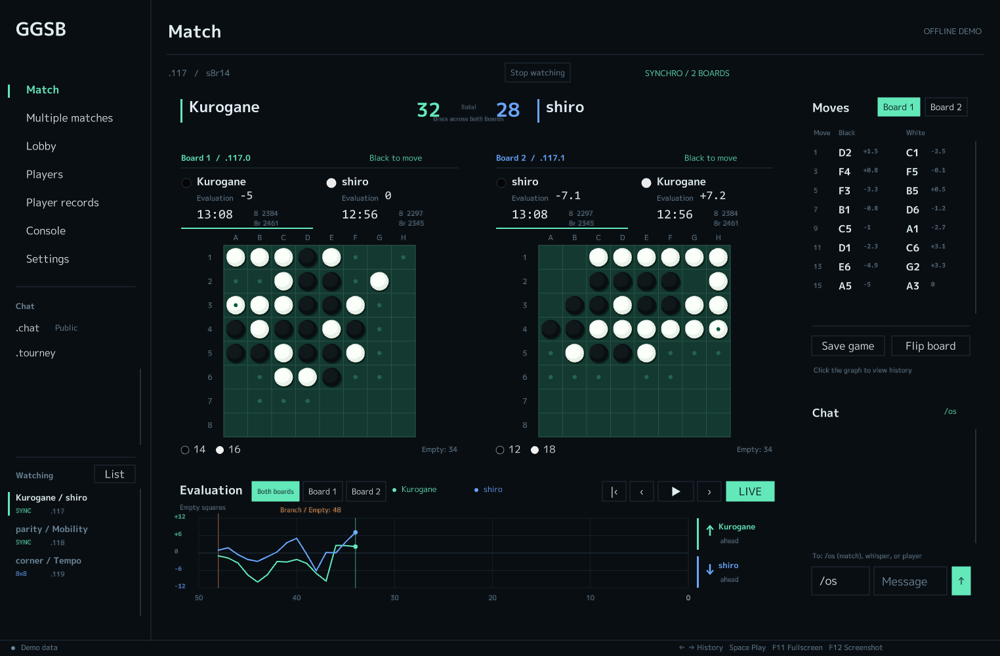
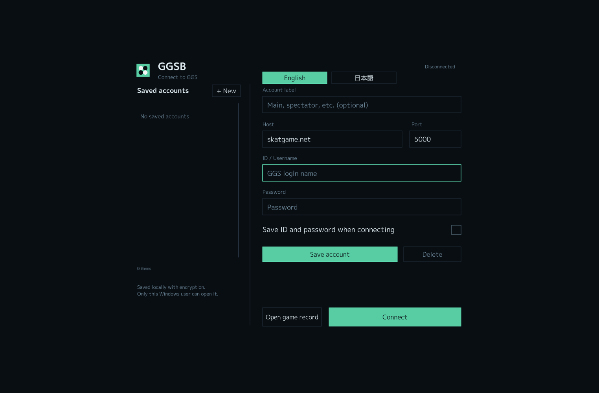
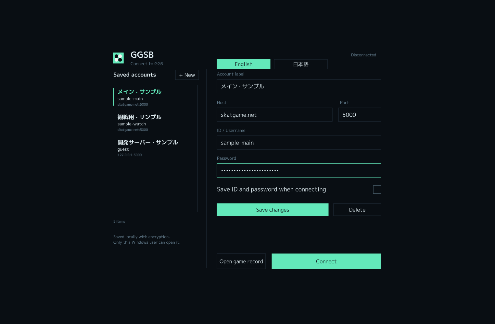
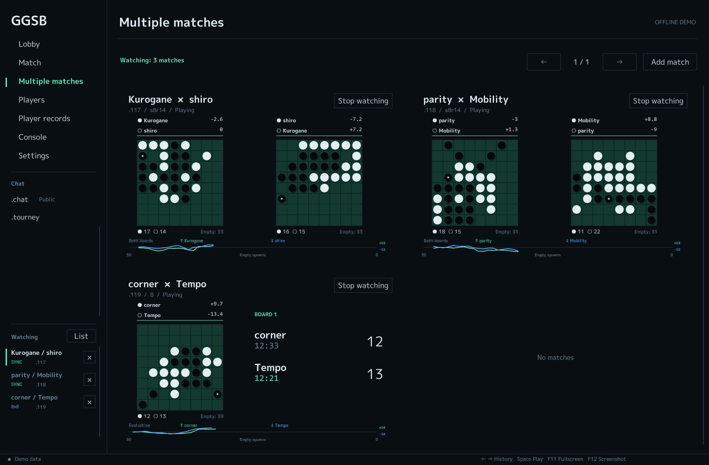
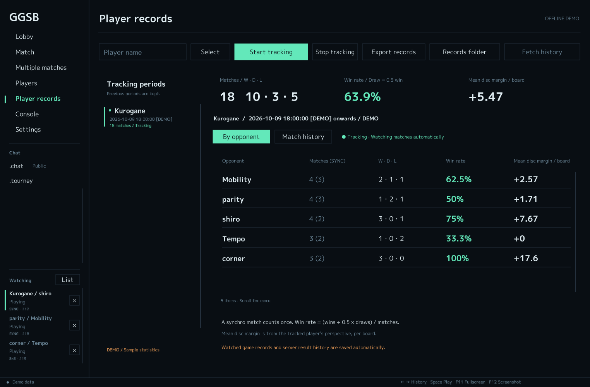
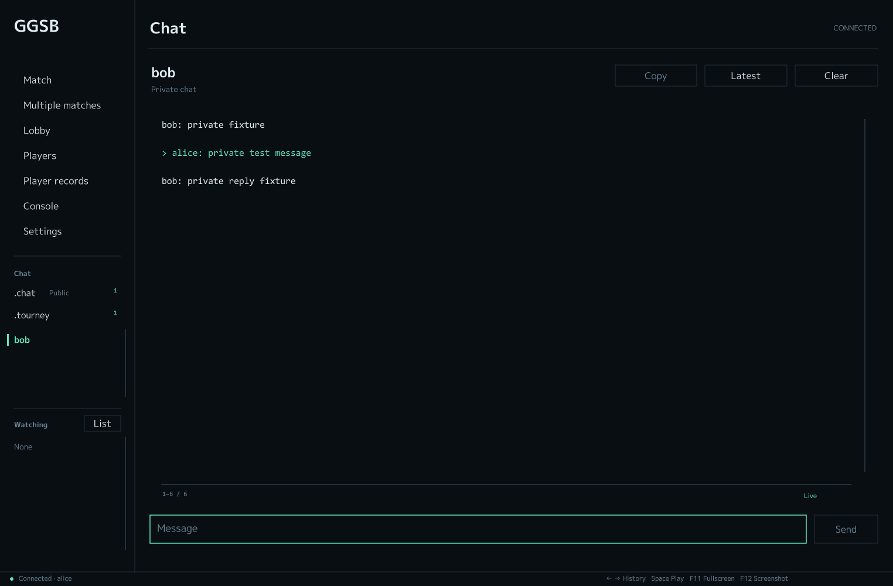

# GGSB

Siv3D 0.6.16で作った、GGS（Generic Game Server）用のオセロGUIです。8×8の通常戦とシンクロ戦に対応し、対局・観戦・棋譜の確認を一つの画面から操作できます。



画像はオフラインデモです。盤面と評価値を再現するための簡易ボットを使っています。

## 起動する

ビルド済みの `App/GGSB.exe` を起動してください。接続画面が開きます。保存済みアカウントを選ぶか、ホスト・ポート・ユーザー名・パスワードを入力して「接続する」を押してください。既定の接続先は `skatgame.net:5000` です。接続待ちや認証失敗時は接続画面に留まり、ログインが完了するとロビーに移ります。



接続するとロビーに対局一覧が表示されます。「観戦する」で盤を開くか、「対局を申し込む」で通常戦・シンクロ戦・ランダム開始局面と時計を設定してください。相手を空欄にすると公開募集になります。届いた申込は、ロビーの「対局募集」から受諾・辞退できます。

未登録アカウントでも観戦できます。未登録であることを理由にエラーは表示しません。対局申込・受諾・対戦設定などの操作は、登録済みアカウントでログインしたときに表示します。

表示設定と前回の接続先は `App/settings.ini` に保存します。IDとパスワードは、接続画面で保存したアカウントから選べます。

表示言語の既定は英語です。接続画面の「English」「日本語」、または設定画面の言語欄で切り替えられます。選択した言語は次回の起動にも引き継ぎます。言語パックのソースは `assets/languages/en.json` と `assets/languages/ja.json` です。セットアップとビルド時に `App/languages/` へコピーします。`strings` 内のキーを維持して値を編集すると、表示文言を変更できます。プレイヤー名・チャット本文・サーバーの応答は翻訳しません。

プレイヤー、対局・募集、保存アカウント、記録区間・成績、棋譜の手順、チャットなどの一覧にはスクロールバーがあります。一覧上のホイール、バーのドラッグ、バーの空いている部分のクリックで移動できます。

## アカウントを保存して選ぶ

接続画面の右側にホスト・ポート・ID・パスワードを入力し、「アカウントを保存」を押してください。保存名には「メイン」「観戦用」など、見分けやすい名前を付けられます。保存すると左側の一覧に表示され、クリックすると接続先とID・パスワードが入力されます。「接続する」でそのアカウントを使ってログインします。



画像のアカウントは説明用のサンプルです。

別のアカウントを追加するときは「＋新規」を押します。保存済みアカウントの名前やパスワードを変えるときは、一覧から選んで入力を直し、「変更を保存」を押してください。「削除」でそのアカウントを保存一覧から取り除けます。複数のサーバー・IDを保存でき、一覧はスクロールできます。

「接続時にID・パスワードを保存」をオンにすると、保存と接続を一度に行えます。前回使った保存済みアカウントは、次回の起動時にも選択されます。保存しない接続もできます。

アカウントは `App/accounts.dat` に、ID・パスワード・保存名・接続先をまとめて暗号化して保存します。暗号化にはWindowsの[DPAPI](https://learn.microsoft.com/en-us/windows/win32/api/dpapi/nf-dpapi-cryptprotectdata)を使い、通常は同じPCの同じWindowsユーザーで復号できます。別のPCやWindowsユーザーへ移す場合は、その環境でアカウントを登録してください。パスワードは画面上で伏せ字にし、ログイン時の通信ログでも伏せ字にします。

復号できないファイルは上書きせず、画面にエラーを表示します。その場合も、保存をオフにして手入力で接続できます。配布用ZIPにはアカウントの保存ファイルを含めません。

## 対局と観戦

- 自分の手番で合法なマスをクリックすると、その着手をGGSに送ります。送信後はサーバーの応答を待ち、同じ着手の重複送信を防ぎます。
- パスが必要な局面では盤の下に「パス」が表示されます。
- 画面上部から中断の申込・投了・スコアの提案を操作できます。通常戦では待ったの申込も使えます。シンクロ戦の待ったはGGS側が対応していないため、ボタンを無効にしています。
- シンクロ戦では2面を並べ、各盤の石数・持ち時間・手番を表示します。2局の手数がずれている間は、先行した盤の時計を止めます。
- 終局後は画面上部に対戦全体の勝者を表示し、ロビーと複数対局の一覧でも勝者を確認できます。中断など公式結果がない対局は「結果なし」と表示します。
- 観戦中の対局は左側から切り替えられます。接続が切れると自動で再接続し、観戦を再開します。
- 「複数対局」では、1ページに4対戦まで同時表示できます。シンクロ戦はそれぞれ2面と合算グラフを表示します。観戦する対局はロビーから追加でき、5対戦以上はページを切り替えて確認できます。「詳細」で通常の対局画面を開きます。
- 「プレイヤー」画面では通常開始の `8` とランダム開始の `8r` のレーティングを並べて表示します。対局画面のID付近にも2種類を表示し、未受信の値は「—」になります。「プロフィール」はGGS本体へ `finger` を送り、「対局成績」は `/os` へ `finger` を送って、コンソールに結果を表示します。対局受付状態の確認や対局申込もできます。



## プレイヤーの対局履歴と相手別の成績

「プレイヤー」の「記録・成績」から対象を選び、「この時点から記録」を押してください。「記録・相手別成績」画面で名前を入力して選ぶこともできます。複数のプレイヤーを同時に記録できます。

記録を開始すると、そのプレイヤーが参加する対局を自動で観戦します。終局通知から相手・種別・結果を保存し、開始局面からの履歴がそろっていれば `App/records/auto/` にGGF棋譜も保存します。「保存した対局履歴」の「開く」から棋譜を再生できます。



相手別の集計は次のように計算します。

| 項目 | 計算方法 |
| --- | --- |
| 対戦数・勝敗 | 通常戦は1局で1対戦、シンクロ戦は2局合わせて1対戦。公式の対戦結果が正なら勝ち、0なら引き分け、負なら負け |
| 勝率 | `(勝ち数 + 0.5 × 引き分け数) ÷ 対戦数` |
| 平均石差 | 自分の視点の公式石差を局数で重み付けして平均。シンクロ戦は2局の平均石差×2を加算し、総局数で割る。表示単位は1局あたり |

平均石差にはGGSの公式結果を使います。空きマスの勝者への加算や、投了・時間切れの結果も反映します。既存の記録はそのまま読み込み、平均石差を再計算します。対戦数の横の `SYNC` はシンクロ戦の内訳です。中断など、結果が付かない対戦は集計しません。

「この時点から記録」をもう一度押すと、新しい区間が始まります。前の区間は左側に残り、切り替えて閲覧できます。区間一覧と成績・履歴の表はスクロールできます。「記録を停止」でその区間への追加を止めます。「履歴・集計を保存」は対象プレイヤーの履歴と、選択した区間の相手別集計をCSVに書き出します。

記録開始時に取得したサーバー履歴を基準として、開始前の対局は新しい集計から除きます。接続中に受信した終局は直ちに追加します。再接続後は、基準より新しい対局IDがサーバー履歴に残っていれば結果を補います。同じIDは重複して数えません。GGSの履歴には保存件数の上限があるため、長く切断していた間の全対局を補えるとは限りません。最初の履歴取得を終える前に切断した場合も、その間の結果を補えないことがあります。

「サーバー履歴を取得」では、サーバーに残っている過去の結果一覧も保存します。この一覧に棋譜が含まれるとは限らず、GGSBが接続中に観戦できた棋譜を自動保存の対象としています。

記録区間と結果は `App/records/players.ggsb` に自動保存し、再起動後も引き継ぎます。前回の保存内容は `.bak` に残します。接続先のホスト・ポートごとに集計を分け、デモのサンプルは実際の記録に混ぜません。

## 評価値グラフと棋譜

グラフの横軸は、その局面の空きマス数です。左から右へ減り、通常の4石からなら60→0、14石からなら50→0の範囲で固定します。パスでは空きマス数は変わりません。

縦軸は左側の選手の視点で見た石差です。初期範囲は−4～+4で、値が収まらなくなったら広がります。シンクロ戦で各盤を表示するときは、両盤の最大値から共通の範囲を決めます。上が左側の選手、下が右側の選手に有利で、矢印と選手名で方向を示します。各選手の評価値は盤面上のIDの下に表示します。

ミント色の線は左側の選手が送った評価値、青色の線は右側の選手が送った評価値を反転したものです。通常戦では1局、シンクロ戦ではパスを除いた着手数を揃えて2局の値を合算します。

各盤のID付近には、黒番・白番がそれぞれ送った評価値を数値で表示します。この数値は各色の視点です。複数対局の画面でも各盤の数値を確認できます。シンクロ戦のグラフは「2局合算」「盤1」「盤2」で切り替えられます。履歴閲覧中は、その手数までに受信した値を表示します。

各選手の評価値がそろうまでは線を描きません。また、パスと合法手が1つしかない局面では直前の値を引き継ぎ、終局後は確定した石差を使います。2局の履歴が同じ着手数で初めて異なった地点には「分岐」を表示します。

グラフをクリック・ドラッグすると、2局をパスを除いた同じ着手数まで戻せます。バーを最新局面の位置まで右へ動かすと、自動でライブ表示に戻ります。グラフの右端まで動かした場合もライブ表示になります。棋譜欄の着手をクリックしても、その局面へ移動できます。履歴閲覧中は着手を送信しません。「最新へ」で現在の盤に戻り、再生ボタンで履歴を順番に確認できます。

「棋譜を保存」では、`App/records/` にGGF棋譜と評価値CSVを保存します。シンクロ戦の棋譜は `_0.ggf` と `_1.ggf` の2ファイルになります。その2ファイルを同じフォルダーに置き、どちらかを開くと2面と合算グラフで読み込めます。GGF棋譜は設定画面の「棋譜を開く」、またはドラッグ＆ドロップで開けます。

GGFには開始局面・着手・選手名・受信した評価値・結果を保存します。各手の時計履歴は保存していないため、GGFの時計設定は `TI[00:00]` としています。

## チャットとコンソール

「プレイヤー」画面の「チャット」を押すと、その人への個人チャットを開きます。メッセージを入力してEnterまたは「送信」で送れます。左側の「チャット」に相手のIDが追加され、クリックして会話を切り替えられます。個人チャットを受信した場合も相手を自動で追加し、未読件数を表示します。相手を切り替えても下書きと表示位置を保持します。相手が多いときは左側の一覧をスクロールしてください。

全体チャットの `.chat` は左側に常設し、ログイン時に自動で参加します。クリックすると全体チャットの履歴と入力欄が開きます。個人チャットと全体チャットは、履歴も送信先も分けています。長いメッセージは画面幅で折り返し、出力の文字選択・コピー・スクロールも使えます。

`.tourney` も左側に常設し、ログイン時と再接続時に自動で参加します。

`/os` など、スラッシュで始まるサービス名もチャットの宛先にできます。たとえば `/os` のタブで `help` を送ると、その返答を同じタブに表示します。盤面や対局一覧の更新は、サービスのタブを開いている間も反映されます。



対局画面のチャット欄では、宛先に `/os` を指定するとその対局の参加者と観戦者に送ります。`whisper` を指定すると観戦者だけに、ユーザー名を指定するとその人へ送ります。対局のチャットは対局IDごとに表示します。

コンソールにはサーバーの応答と送信コマンドが表示されます。たとえば `t /os history ユーザー名` で対局履歴、`t /os stored` で保存された対局、`t /os continue .ID` で保存対局の再開を操作できます。送受信ログは `App/logs/` に保存します。

コンソールの出力と入力欄は等幅フォントです。縦横のスクロールバーをドラッグして移動できます。出力欄をクリックしてから、PageUp / PageDownで1ページずつ、Home / Endで先頭・末尾へ移動できます。過去の出力を読んでいる間は、新しい応答を受信しても表示位置を維持します。「最新に戻る」で末尾の表示に戻ります。

出力をドラッグすると複数行の文字を選択できます。Ctrl+Cまたは「コピー」で選択部分をコピーし、Ctrl+Aで全出力を選択できます。

## キーボード操作

| キー | 操作 |
| --- | --- |
| ← / → | 1手戻る / 進む |
| Home / End | 開始局面 / 最新局面 |
| Space | 棋譜再生を開始・停止 |
| F1 | Siv3Dと同梱ライブラリーのライセンスを表示 |
| F11 | 全画面表示を切り替える |
| F12 | `App/Screenshot/` に画面を保存 |
| Tab / Shift+Tab | 入力欄を移動 |
| Ctrl+A / C / V | 入力欄の全選択・コピー・貼り付け |
| Esc | ダイアログを閉じる |

## ソースからビルドする

Windows、Visual StudioのC++開発環境、MSVC v143、[Siv3D 0.6.16 SDK](https://siv3d.github.io/ja-jp/download/windows/) が必要です。環境変数 `SIV3D_0_6_16` をSDKのフォルダーに設定してください。

```powershell
./tools/setup.ps1
./tools/build.ps1
```

`setup.ps1` はインストール済みのSiv3Dプロジェクトテンプレートから `App/` のリソースを配置します。自動で見つからない場合は `-TemplateZip "テンプレートZIPのパス"` を指定できます。`App/engine/` と `App/dll/` はGitの管理対象から外しています。

Visual Studioからは `GGSB.sln` を開き、Release / x64でビルドしてください。VS 2026とv143を併用する環境では、`build.ps1` がコンパイラーのDLL検索パスも設定します。

ビルド後、実行ファイルに埋め込まれた診断用ソースパスはファイル名だけを残し、ライブラリのビルド環境のパスも除去します。`python tests/binary_privacy_tests.py` で、コード・リソース・ファイルサイズを変えずに処理できることを確認できます。

配布用ZIPは次のコマンドで `build/GGSB-windows-x64.zip` に作れます。設定・パスワード・通信ログ・保存棋譜はZIPに含めません。

```powershell
./tools/package.ps1
```

## テストと画面確認

MinGWの `g++` がある環境で実行できます。

```powershell
./tools/test.ps1
./tools/test.ps1 -Network
./tools/test.ps1 -ExistingLog "GGS_Streamの通信ログのパス"
./tools/gui-smoke.ps1
```

コアテストはルール・パス・履歴復元・シンクロ評価値・各盤の共通縦軸・勝者判定・分岐・GGFの保存と読込・コマンドの書式に加え、登録状態による着手制限、スクロールバーの先頭・末尾と件数変更、細かいホイール入力、コンソールの範囲選択・スクロール・受信中の表示位置維持、勝率・平均石差・集計区間・重複通知・履歴の補完・記録の復元を検証します。アカウント保存テストでは、Windows DPAPIでの暗号化・復号、追加・更新・削除、再読み込み、破損したファイルの保護、書き込み失敗時の処理を確認します。

通信テストは127.0.0.1の模擬サーバーを使い、登録済み・未登録のログイン、登録状態の判定、通常・ランダムのレーティングの受信、チャンネル参加、分割受信・切断・再接続・認証失敗・パスワードの伏せ字・終了処理を検証します。GUIテストは実際のSiv3Dアプリで、起動時の接続画面・デモの停止・未接続時の対戦操作の制限・言語の切り替えと保存・コンソールの範囲選択・フォントの読込、棋譜の書き出し・2局の読み込み・再生時の着手禁止・終局通知からの自動棋譜保存と集計の復元に加え、アカウントの保存・選択・再読み込み・削除を確認します。`python tests/language_tests.py` で両言語パックのキーと翻訳の不足を確認できます。

GUIテストは実行ファイルとランタイムだけを `build/` 内の専用フォルダーへコピーして実行します。普段使う `App/settings.ini`、保存済みアカウント、対局記録をテストに読み込まず、実行後にも接続設定が変わっていないことを確認します。

Python 3が使える環境では、`python tests/gui_session_smoke.py` で登録済み・未登録のログインを実際のアプリで確認できます。このテストではローカルの模擬サーバーだけに接続し、ログイン後のロビー表示、2種類のレーティング、プロフィールと対局成績の問い合わせ先、個人チャット・全体チャットの送受信、対戦操作の表示可否、未登録時に対戦設定コマンドを送らないことを検証します。

`python tests/privacy_tests.py --history --package build/GGSB-windows-x64.zip` で、公開対象・現在のブランチの履歴・配布ZIPに絶対パスや内部ネットワークのアドレスが残っていないか確認できます。検出した値は出力しません。

画面確認用に、次の起動オプションを使えます。

```powershell
cd App
./GGSB.exe --mute --screen lobby --capture Screenshot/ggsb-lobby.png --capture-at 2 --quit-after 3
```

`--screen` は `arena`、`lobby`、`requests`、`players`、`console`、`settings`、`multi`、`records`、`history`、`challenge`、`connect`、`chat`、`global-chat`、`tourney-chat`、`service-chat` に対応します。そのほか、`--single`、`--empty`、`--review 手数`、`--load 棋譜パス` を指定できます。`--language en` / `ja` は設定を保存せずに表示言語を指定します。対局のサンプルが必要な画面確認では、先に `--demo` を付けてください。起動時や通常の画面操作ではデモを再生しません。

`--console-preview` は文字選択とスクロールの確認用出力を表示します。`--graph-board 0` / `1` はシンクロ戦の盤1 / 盤2のグラフを表示します。

`--demo-accounts` は画面確認用のサンプルアカウントを表示します。サンプルは `records/gui_smoke/` に保存し、実際の `accounts.dat` には混ぜません。

本番GGSでの認証・対局はアカウントを入力して確認してください。現在の検証はソースに記載された通信仕様、GGS_Streamの既存ログ、ローカルの模擬サーバーを使っています。盤サイズは8×8に対応し、コミ入札戦・アンチオセロ・その他の盤サイズはGUIの対象から外しています。

## ソース構成

| ファイル | 内容 |
| --- | --- |
| `Main.cpp` | Siv3Dの起動・画面ループ・起動オプション |
| `src/application.hpp` | 接続・画面操作・保存・言語選択 |
| `src/screens.hpp` / `src/ui.hpp` | 盤・グラフ・ロビー・入力欄などの描画 |
| `src/notebook_screens.hpp` | 複数対局と相手別成績の画面 |
| `src/console.hpp` / `src/console_screens.hpp` | コンソールの文字選択・スクロール・等幅表示 |
| `src/chat_screens.hpp` | 個人チャット・全体チャットの表示と入力 |
| `src/scroll.hpp` | 一覧のスクロール位置・ホイール・ドラッグ |
| `src/language.hpp` / `assets/languages/` | 日本語・英語の言語パック |
| `src/tracking.hpp` / `src/tracking_application.hpp` | 記録区間・履歴・統計・自動観戦・保存 |
| `src/accounts.hpp` / `src/account_application.hpp` | アカウントの暗号化保存と接続画面の選択操作 |
| `src/model.hpp` | 対局状態・評価値・時計・GGF・コマンド |
| `src/othello.hpp` | 8×8のオセロルール |
| `src/protocol.hpp` | GGSメッセージの区切りとパース |
| `src/network.hpp` | 通信スレッド・認証・再接続・ログ |
| `src/demo.hpp` | デモの盤面生成と簡易ボット |
| `tests/` | Siv3Dを使わないコア・通信テスト |
